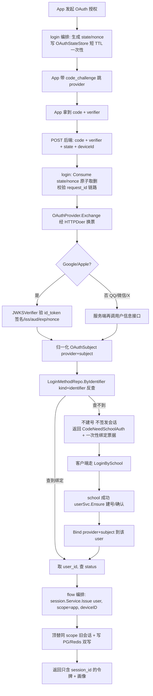

# 调研：手机端 QQ / 微信 / Google / X / Apple 五家 OAuth 登录的后端落点

> **本文性质**：调研笔记，不是规格、不是实施计划、不含任何代码或 DDL。按本仓 SDD 流程，业务接口开发前仍须先补 PRD 与 `docs/specs/` 下的规格（见 `README.md` 第 77–80 行「开发流程（SDD）」）。
> **范围**：只基于本仓库既有的设计文档与现有代码骨架，研究「后端如何落地」；不凭空发明一套新架构去覆盖既有决定。
> **硬边界**：本次只新增本文件，未改动任何 `.go` 文件、`go.mod` 或其它既有文件（任务要求）。
>
> **标记图例**（全文严格区分）：
> - **【已定】** = 既有文档里维护者已拍板、或代码已落地的事实，不得推翻。
> - **【建议（待维护者确认）】** = 本文的推断，需维护者确认后才算数。
> - **【可由官方事实定】** = 由各家公开协议/文档可判定的事实，仍建议实测确认当前版本。
> - **【必须人拍板】** = 文档与官方事实都定不了，必须由维护者/产品决策。

---

## 一、范围与依据

**读了哪些一手依据**（逐一用 read 读过，非转述）：

| 类别 | 文件 |
| --- | --- |
| 术语 | `GLOSSARY.md` |
| 领域模型 | `docs/tech/领域模型-用户与登录-消息.md` |
| 架构落点 | `docs/tech/架构落点-身份仓.md` |
| 数据边界 | `docs/adr/0002-身份仓数据边界.md` |
| 出站边界 | `docs/adr/0001-服务端代请求边界由新后端重写.md` |
| 持久层 / Redis | `docs/tech/持久层结构.md`、`docs/tech/Redis基础能力与边界.md` |
| 工程约束 | `AGENTS.md`、`README.md`、`go.mod` |
| 代码骨架（只扫读，未改） | `internal/platform/capabilities.go`、`internal/platform/identity.go`、`internal/platform/store.go`、`internal/platform/audit.go`、`internal/platform/mail.go`、`internal/identity/identity.go`、`internal/identity/login/service.go`、`internal/identity/session/service.go`、`internal/identity/user/service.go`、`internal/identity/flow/service.go`、`internal/identity/flow/handler.go`、`internal/server/auth.go`、`internal/server/requestid.go`、`internal/config/config.go`、`internal/app/app.go`、`cmd/server/main.go`（目录由 glob 确认） |

**两个必须先说清的前提**：

1. **文档状态不一致**：`docs/tech/领域模型-用户与登录-消息.md` 与 `docs/tech/架构落点-身份仓.md` 都自称「讨论稿，2026-11-08，尚未落代码」（见两文首段）；但 `internal/identity/` 下 `login/`、`session/`、`user/`、`flow/` 四个包的代码**已经存在**。`docs/adr/0002-身份仓数据边界.md` 状态是 `accepted`（见其第 3 行）。**本文取舍**：凡「文档讨论稿」与「已落地代码」冲突，以**代码 + ADR（accepted）+ 架构落点第九节「结构已定格」**为准；文档仅作为「设计意图」的依据。详见 §2.5。
2. **当前依赖事实**：`go.mod` 的直接依赖只有 `github.com/gin-gonic/gin` 与 `github.com/redis/go-redis/v9`（见 `go.mod` 第 5–8 行），**没有任何 oauth2 / OIDC / JWT-JWKS 验签库**（`golang.org/x/oauth2` 不在直接也不在间接依赖里；间接依赖里只有 `golang.org/x/crypto`）。因此「谁来做 id_token 验签」是一个绕不开的选型问题（见 §7.3）。

---

## 二、与既有模型的关系

### 2.1 OAuth 属于哪种「登录方式」

**【已定】** OAuth 是「**登录方式**」这一术语下的一种，不是新的「用户」、不是新的「学校身份」。

- `GLOSSARY.md` 第 53–55 行「登录方式」第二版：**当前四种**：学校统一身份认证（账密/微信/电话）、农屿账密、农屿邮箱验证码、身份证后四位加姓名拼音首字母；**将来可能加手机号与各类 OAuth**。
- `docs/tech/领域模型-用户与登录-消息.md` 第三节表格最后一行：「**未来** | 手机号 / 微信 / QQ / Google / X 等 OAuth | 各提供方凭据 | **是（要求用户已存在）**」。
- `docs/tech/领域模型-用户与登录-消息.md` 第一节「一张图」与第二节 ER 图：`用户 ──1:N──▶ 登录方式`、`USER ||--o{ LOGIN_METHOD`——多条登录方式绑到**同一个**用户；`GLOSSARY.md` 第 38 行明说「多种登录方式绑定到同一个用户上，不产生多个用户」。
- 代码印证：`internal/platform/identity.go` 第 64–76 行 `LoginMethodKind` 现有四个常量 `"school" / "password" / "mailcode" / "idcard"`；`internal/identity/login/service.go` 文件头注释「四种登录方式（见领域模型第三节）」。OAuth 应是**第 5+ 种 kind 的扩展**，不是新实体。

**【已定】** 根本理由：`GLOSSARY.md` 第 29–31 行「学校身份：……它是农屿识别『这是谁』的**唯一来源**；……不可由农屿自行创建」、第 33–35 行「用户……与学校身份一一对应……只能由某次登录首次确认学校身份时产生」。第三方的 `sub/openid` 不是学校身份，天然没有资格当「用户」的主键，只能当「证明你已拥有某个用户」的一条途径。

> 这一条直接决定了 §2.4：identifier 漂移**不会**把一个人分裂成两个用户（因为学号才是唯一身份锚），只会导致「该绑定行反查不到用户」。

### 2.2 `login_methods` 的 `kind` / `identifier` / `secret_ref` 三列如何承载

三列的出处：**【已定】**
- `docs/tech/领域模型-用户与登录-消息.md` 第二节 ER 图 `LOGIN_METHOD` 块（第 41–48 行）：`kind "四种之一，见下"`、`identifier "学号 / 邮箱 / OAuth openid"`、`secret_ref "凭据；密码镜像在此"`。
- `docs/tech/架构落点-身份仓.md` 第六节表（第 130 行）：`login_methods | id, user_id, kind, identifier, secret_ref, bound_at | 四种方式各一行`。
- 代码：`internal/platform/identity.go` 第 78–87 行 `LoginMethod{Kind, Identifier, SecretSealed, BoundAt}`；第 138–149 行 `LoginMethodRepo.Bind / ByIdentifier / ByUserAndKind / UpdateSecret / Unbind`，其中 `Bind` 对 `(kind, identifier)` 或 `(user_id, kind)` 冲突返回 `ErrAlreadyExists`。

**【建议（待维护者确认）】** 三列承载方式：

| 列 | 建议内容 | 理由（引用） |
| --- | --- | --- |
| `kind` | 一 provider 一个 kind，例如 `oauth:qq` / `oauth:wechat` / `oauth:google` / `oauth:x` / `oauth:apple`（`LoginMethodKind` 本身是 string 常量，`internal/platform/identity.go` 第 64–76 行，扩展常量即可，不必改类型） | ① `ByIdentifier(kind, identifier)` 按 `(kind, identifier)` 反查（第 141–142 行），按 provider 分区后不同家的 subject 即使碰巧同值也不会串；② 现有 `(user_id, kind)` 唯一约束（第 139 行注释）在 `kind=oauth` 单值时会让「一个用户只能绑一家 OAuth」，与 `GLOSSARY.md` 第 38 行「多种登录方式绑定到同一个用户上」冲突——按 provider 拆 kind 才能同时满足「一人绑多家」与「一家只绑一条」。 |
| `identifier` | provider 侧**稳定唯一主体标识**：QQ `openid`/`unionid`、微信 `unionid`、Apple `sub`、Google `sub`、X 数字 user id | 领域模型 ER 图已明写 `identifier "…… OAuth openid"`（第 45 行）。**不放** code / access_token / refresh_token / id_token / 昵称 / email（会变、会重复、属凭据）。 |
| `secret_ref` | **保持空 / nil**，表示「本方式无本地密钥，靠 provider 验签」；或最多放一个**不可解密**的短期引用句柄，绝不放假任何第三方 token 或其密文 | 领域模型第 46 行说 `secret_ref` 是「凭据、密码镜像在此」，但那是为**农屿账密**写的。OAuth 没有本地密码可镜像；按 §6 的数据边界，第三方 token 不应长期驻留在这张权威业务表里。**该行到底放什么属【必须人拍板】**（见 §7.3 第 4 条）。 |

### 2.3 各家 identifier 该用什么、跨应用/跨端的稳定性风险

**【可由官方事实定 + 必须实测确认】** 逐家：

| Provider | 建议 identifier | 稳定性边界（风险） | 校验方式（见 §4.3） |
| --- | --- | --- | --- |
| QQ | 优先 `unionid`，否则 `openid` | `openid` 只对**单个 appid** 稳定；换应用/换包名/换 appid 就变。`unionid` 需同一 QQ 互联开发者账号下打通，是否对所有 appid 开放需实测 | 非 OIDC，服务端再调用户信息接口 |
| 微信 | **必须 `unionid`**，不用 `openid` | `openid` 只对单个应用（公众号/开放平台应用/小程序）稳定；`unionid` 在**同一微信开放平台账号**下跨应用唯一。若没绑开放平台账号拿不到 unionid，换端即漂移 | 非 OIDC，服务端再调用户信息接口 |
| Apple | `sub` | Apple 没有 unionid；`sub` 按 **team + bundle/service id** 范围稳定。iOS 原生 App 与「Android/Web 走 Apple REST/JS」两条路径的 `sub` **很可能不同**，跨端同一 Apple ID 会被当成两个绑定（见 §7.3 第 2、10 条） | 标准 OIDC，JWKS 验签 `id_token` |
| Google | `sub` | `sub` 对**单个 `client_id`** 稳定，换 client_id 会变；**不要用 email**（可变、可重复、可伪造） | 标准 OIDC，JWKS 验签 `id_token` |
| X (Twitter) | 数字 `user id`（`/2/users/me` 的 `id`） | X OAuth 2.0 不是标准 OIDC（是否发标准 `id_token` 需实测）；`@handle` / 用户名可变，**不能**当 identifier | 服务端再调用户信息接口 |

**【必须人拍板】** 「换 client_id / 换包名 / 换开发者账号导致 identifier 漂移」的产品对策：是否允许重新绑定、是否需要先解绑旧绑定、是否把「旧 identifier」留一张映射表。注意**留映射表本身就是新的数据边界**（那是「第三方账号 → 学号」的映射，见 §6）。

**【已定】** 一个重要的**正面**性质：因为学号才是唯一身份锚（`GLOSSARY.md` 第 29–31 行），identifier 漂移的后果被限制在「该绑定行 `ByIdentifier` 查不到 → 走 §2.4 的『需先学校认证』分支」，**不会**造成重复用户。这反过来说明「OAuth 不得建号」这条约束在架构上是自洽的、不能被绕过。

### 2.4 「OAuth 不得独立建号」的已定语义

**【已定】** 这是全篇最硬的一条，三处文档 + 代码一致：

- `docs/tech/领域模型-用户与登录-消息.md` 第三节第 83 行「**核心约束（维护者原话）**：*学校统一身份认证是唯一注册所需的，其他方式注册时也要再走这一步。*」；第 85 行「所以『无感注册』对 2/3/4/OAuth 的表现是：**用户不存在 → 登录失败 → 引导走一次学校认证 → 回来建号并绑定该方式**」；第三节表格「未来 OAuth …… **是（要求用户已存在）**」。
- `docs/tech/架构落点-身份仓.md` 第七节流程图第 158–159 行：「用户存在？ ─ 否 ─▶ **非 school 方式：返回『需先完成学校认证』**；school 方式：建用户（无感注册）＋ 绑方式」。
- `GLOSSARY.md` 第 57–59 行「无感注册」**第二版**：「**只有学校统一身份认证能直接建号**；其余登录方式在用户不存在时必须先走一次学校认证，才能建号并绑定该方式」。
- 代码：`internal/identity/identity.go` 第 44–45 行 `CodeNeedSchoolAuth`「非学校方式的登录找不到用户，必须先完成一次学校认证」；`internal/identity/login/service.go` 文件头第 9–14 行「除 school 外的三种方式，在用户不存在时一律返回 CodeNeedSchoolAuth」；`LoginByPassword / LoginByMailCode / LoginByIDCard` 三处都返回它（第 263–369 行），只有 `LoginBySchool` 调 `userSvc.Ensure`（第 217 行，见 `internal/identity/user/service.go` 第 55–76 行「Ensure 按学号取得用户；不存在则创建（**无感注册的落点**）」）；`internal/identity/flow/service.go` 第 92–96 行还有一层兜底。

**【建议（待维护者确认）】** OAuth 回调成功但用户不存在的分支，必须与上述三种非 school 方式**完全同构**：

1. 用 `(kind, identifier)` 走 `LoginMethodRepo.ByIdentifier` 反查绑定行（见 `internal/platform/identity.go` 第 141–142 行）；
2. 查不到 → **不建号**、**不签发会话**（领域模型第 85 行「登录失败」），返回 `CodeNeedSchoolAuth`（`identity.go` 第 44–45 行）；
3. 同时把「这次 OAuth 已验证通过的 `provider + subject`」暂存为**一次性绑定票据**，让客户端接着走一次 `LoginBySchool`，school 成功后由编排层把该 subject 绑定到刚确认/建好的 user 上；
4. 绑定动作落在 `login` 子域（现有 `bindOrIgnore` 就在 `internal/identity/login/service.go` 第 434–442 行），经 `userSvc.Ensure` 走 `login → user`（允许方向）。

**【已定】** 「先有会话再绑」的主路径身份来源：`internal/app/app.go` 第 310–311 行「身份全部来自 context，不读请求体里的 userID」；`internal/identity/flow/handler.go` 第 3 行「HTTP handler 只做翻译」。绑定不能由客户端在请求体里报一个 userID 来指定「绑给谁」。

### 2.5 文档内部不一致与取舍（硬性要求，逐条点出）

| # | 不一致 | 两版 / 两处 | 本文以哪份为准，为什么 |
| --- | --- | --- | --- |
| 1 | **`GLOSSARY.md`「登录方式」条目重复且两版措辞不同** | 第 37–39 行第一版：列举「学校统一身份认证、农屿账密、农屿邮箱验证码，**以及将来的手机号与各类 OAuth**」（把 OAuth 放在「将来」，且**没列**身份证后四位为当前方式）；第 53–55 行第二版：「**当前四种**：……、身份证后四位加姓名拼音首字母；将来可能加手机号与各类 OAuth」 | **以第二版（第 53–55 行）为准**。理由：① 与 `docs/tech/领域模型-用户与登录-消息.md` 第三节「四种登录方式」表格完全对齐；② 与代码 `internal/platform/identity.go` 第 67–76 行四个 `LoginMethodKind` 常量、`internal/identity/login/service.go` 文件头「四种登录方式」完全对齐。第一版是漏写「身份证后四位」的旧稿。**但两版一致处（OAuth 属「将来」的登录方式）可放心采用**（见 §2.1）。 |
| 2 | **`GLOSSARY.md`「无感注册」条目重复且两版语义直接冲突**（最重要） | 第 41–43 行第一版：「用户尚未存在时，一次成功登录顺带创建用户……**任何登录方式都遵循此语义**」→ 任何方式都能建号；第 57–59 行第二版：「**只有学校统一身份认证能直接建号**；其余登录方式在用户不存在时必须先走一次学校认证」→ 只有 school 能建号 | **以第二版（第 57–59 行）为准**。理由：① 它是维护者原话的落点，与 `领域模型` 第三节第 83 行「核心约束（维护者原话）」一致；② `架构落点` 第七节流程图第 158–159 行明确「非 school 方式：返回需先完成学校认证」；③ 代码三处一致：`identity.go` 的 `CodeNeedSchoolAuth`、`login/service.go` 文件头与三个非 school 方法、`flow/service.go` 第 92–96 行兜底。**第一版「任何登录方式都遵循此语义」是错的/过时的**，若按它实现就会让 OAuth 独立建号，直接违反全篇最硬的约束。 |
| 3 | **领域模型「身份证号 / 学院口径」与 ADR-0002 二修冲突** | `领域模型` 第五节（第 117–122 行）：「统一身份认证下发……姓名、身份证号……」「统一身份认证**只下发**姓名/身份证/生日/性别/手机号，**不下发**专业、班级、**学院**、年级——后者必须从教务 `bjiben.asp` 抓取」「学院……需要从教务抓取」；`ADR-0002` 第 2b 节（第 56–65 行）：「实测 `ywtb` 账户信息含 `所属单位：信息工程学院`，因此**学院取自认证结果的『所属单位』**；专业/班级/年级仍需从教务抓」「知识库笔记称『统一身份认证不下发学院』——该结论对 `ywtb` 这个应用**不成立**……实现要按『有则用、无则回落』处理」 | **以 `ADR-0002` 第 2b 节为准**。理由：① ADR 状态是 `accepted`（第 3 行），且二修明确「**都以实测为准**」（第 30 行）；② 代码已按此落地：`internal/identity/login/service.go` 第 100–109 行 `SchoolIdentity.College` 注释「取自认证结果的『所属单位』；没有时才回落教务抓取值」、`IDCardFull`「ywtb API 会返回」完整号；`LoginBySchool` 第 225–243 行确实加密完整号并同步画像。③ `领域模型` 自己第 128 行也已承认「隐私口径（**已被 ADR-0002 部分覆盖**）」。`领域模型` 是讨论稿、且早于 11-09 实测。**注**：这一冲突不直接影响 OAuth（OAuth 不写学校档案字段，见 §6），但会影响「OAuth 回调后展示的画像从哪来」的正确理解。 |
| 4 | **`ADR-0002` 文档内部自相矛盾（同一份 ADR）** | 第 2 节「决定」（第 28–45 行）：二修「**完整号是拿得到的**……恢复初版决定：加密存储完整身份证号、允许经接口返回」；但「备选方案与否决理由」第 3 条（第 89–90 行）仍写「2026-11-09 实测发现**完整号拿不到**，遂改为采纳（只存后四位）」 | **以第 2 节「现决定」为准**。理由：① 第 2 节是 ADR 的「决定」正文且有完整实测证据（第 34–36 行给出返回体里的 `"idcard": "650102200701142614"`）；② 第 89–90 行是**一修误判的残留文案**，与第 2 节「二修恢复初版」的修订叙事直接矛盾，属修订时未同步清理；③ 代码 `internal/identity/login/service.go` 第 107–109、225–234 行与 `ADR-0002` 待办第 106–111 行都按「存完整号 + 两把独立密钥」落地。**建议维护者回填修正第 89–90 行**（本文只记录，不改文件）。 |
| 5 | **架构落点「两个子域」措辞 vs 实际三个（+ 代码第四个 flow）** | `架构落点` 第一节标题「三块 vs 一个域两个子域」、第 11 行「一个业务域、**两个子域**」；但第 14–17 行表格列了 login/session/user **三行**、第 184 行第九节「下设 `login/`、`session/`、`user/`」；代码 `internal/identity/` 实际还有第四个包 `flow/`（`internal/identity/flow/service.go` 文件头「维护者选择『**独立编排层**』」） | **以第九节「结构已定格（维护者拍板）」（第 180–187 行）+ 代码为准**：业务域是 `identity/`，下设 login / session / user，**外加代码里已存在的 `flow/` 编排层**。`flow` 是讨论稿之后新增的（把「登录 + 签发会话」从 `login.Service.Login` 里抽出来，见 `flow/service.go` 第 3–9 行）。**后果**：本文 §5 的会话衔接按 `flow` 编排层描述，而不是退回 `架构落点` 第七节里「`login.Service.Login` 直接签发」的旧图形——这是「别用讨论稿覆盖已落地代码」的具体体现。 |
| 6 | **`SchoolAuthenticator` / `SecretBox` 的放置：文档说 platform，代码在 login 子域** | `架构落点` 第五节表（第 104、106 行）把 `SchoolAuthenticator`、`SecretBox` 都列在「`platform` 需要新增的接口」；但代码 `internal/identity/login/service.go` 第 27–33 行把 `SchoolAuthenticator` 定义在 **login 子域**、第 124–129 行把加解密能力定义为 `login.Secrets`（`Seal/Open`），`internal/app/app.go` 第 169 行用的是 `identitylogin.SchoolAuthenticator`、第 271–272 行注入的是两个 `platform.NewMockCipher` 实例 | **以代码为准**，并在 §3.2 按「代码的真实风格」给建议：provider 认证/验签类接口放 login 子域（与 `SchoolAuthenticator` 同处），存储/加密/出站闸口放 `platform`（`SessionStore`、`LoginMethodRepo`、`Cipher`、`HTTPDoer` 确实在 `internal/platform/`）。若维护者更想严格照文档把 provider 接口放 platform，属 **【必须人拍板】**（§7.3 第 1 条的延伸）。 |
| 7 | **「复用已有的 RateLimiter / RequestID」文档语境 vs 代码位置** | `架构落点` 第五节第 109 行「**复用已有的**：`Clock`、`AuditStore`、`RateLimiter`、`RequestID`」，写在 `platform` 接口清单之下，易读成 platform 能力；但代码 `internal/server/auth.go` 第 113 行 `RateLimiter`、`internal/server/requestid.go` 第 17 行 `RequestIDMiddleware` 都在 **server 框架适配层**，不是 platform 接口 | **以代码为准**：`Clock`（`internal/platform/capabilities.go` 第 72 行）、`AuditStore`（`internal/platform/audit.go`）、`Cipher`（第 41 行）真在 platform；`RateLimiter` / `RequestID` 是 server 中间件。**建议**：OAuth 的限流与流水号复用 server 中间件，**不新建 platform 接口**（见 §3.3）。 |

---

## 三、新增 / 复用清单

### 3.1 扩展 `login/` 子域，不新建顶层子域

**【已定 + 建议】** 结论：**扩展 `internal/identity/login/`，不新建顶层业务子域**。

- **【已定】** `docs/tech/架构落点-身份仓.md` 第九节第 184 行「业务域：`internal/identity/` 一个域，下设 `login/`、`session/`、`user/`」是维护者拍板「结构已定格」（第 180 行）；新建子域等于推翻已定结构。`README.md` 第 42–48 行架构约束 1、2（业务域不互相 import、只依赖 platform 接口）也不允许为 OAuth 开旁路。
- **【已定】** OAuth 是「登录方式的一种」（§2.1），而 `login/` 的职责正是「确认你是谁」（`internal/identity/flow/service.go` 第 4–5 行「login 子域只负责『确认你是谁』，不该知道会话怎么签」）。
- **【建议（待维护者确认）】** 落点形状沿用 `架构落点` 第二节第 31–36 行「每种方式一个文件」的既有风格（`idcard.go` / `mailcode.go` / `credential.go`）：在 `login/` 下加一个 `oauth.go` 做编排，五家差异封在 `login/` 内的 provider 适配文件（或一个 `login/oauth/` 内部子包，**仍属 login 子域，不是新的顶层子域**）。`login.Service` 增加一个 `LoginByOAuth(ctx, provider, code, verifier, bindTicket)` 分支，与现有 `LoginBySchool / LoginByPassword / LoginByMailCode / LoginByIDCard` 平级（见 `internal/identity/login/service.go` 第 200–369 行）。

### 3.2 `platform` 新增接口清单（用途 + 最小方法集；**不写代码、不写 DDL**）

命名与放置风格参照 `SchoolAuthenticator`「让 X 确认 Y」、`SecretBox`/`Secrets`「加解密能力」、`SessionStore`「存储能力 + 一次性/吊销」；并遵循 §2.5 第 6 条「以代码为准」的放置结论。

| # | 接口（建议名） | 放哪 | 用途 | 最小方法集（纯语义描述，非代码） |
| --- | --- | --- | --- | --- |
| 1 | `OAuthProvider`（参照 `SchoolAuthenticator`） | `identity/login/` 子域（与 `SchoolAuthenticator` 同处） | 把五家协议差异封在适配内：服务端换票 + 验证第三方身份，向上只交归一化主体 | `Exchange`：用 code + verifier + redirectURI 向 provider 换票（出站经 `HTTPDoer`）；`Verify`：验 `id_token` 或再调用户信息接口，产出 `OAuthSubject{Provider, Subject}`；`Kind`：返回该 provider 对应的 `LoginMethodKind`（用于 §2.2 的 `kind`/`identifier` 编码） |
| 2 | `OAuthStateStore`（参照 `SessionStore` 的一次性/吊销语义、邮箱验证码存储的短 TTL 形态） | `platform`（实现放 `platform`，注入给 login） | 服务端持有 `state` / `nonce` / `code_challenge` / 绑定意图；state 本身只带不可猜的随机句柄 | `Put`：一次性写入 + TTL；`Consume`：原子「取出并删除」（重放无效，参照 `架构落点` 第六节第 137 行邮箱验证码「校验成功即删除该 key（一次性；重放无效）」）；可复用 `Redis基础能力` 第三节第 41–47 行的幂等锁防重复回调 |
| 3 | `OAuthBindingTicket`（一次性绑定票据） | `platform`（短 TTL 存储，与会话持久票据**分开**，见下） | §2.4 第 3 步「OAuth 成功但用户不存在」的跨请求续传载体，只装 `provider + subject`，**不装任何 token** | `Issue`：签发一次性票据 id；`Consume`：原子取出并删除，返回已验证的 `OAuthSubject` |
| 4 | `JWKSVerifier` / `TokenVerifier`（谁能用 JWKS 验签的那两家） | `platform` 或 `login`（**【必须人拍板】**，见 §7.3 第 5 条） | 验 Apple / Google 的 `id_token` 签名与 `iss/aud/exp/nonce`，带 JWKS 拉取与密钥轮换缓存 | `VerifyIDToken`：验签并返回 claims（用 `Clock` 判 `exp/iat/nbf`）；`KeySet`：按 provider 取/缓存 JWKS（出站经 `HTTPDoer`） |
| 5 | `OAuthClientConfig` / `SecretBox`（密钥与配置） | `platform` | 集中 `client_id` / `client_secret` / `redirect_uri` / JWKS URI / Apple ES256 私钥；**不进代码仓、不进镜像** | `ClientID`、`ClientSecret`、`RedirectURI`、`JWKSURI`（按 provider 取）；密钥经 `Cipher` 解密后注入，不暴露明文 |
| 6 | `LoginMethodRepo`（**扩展现有，不新建**） | `platform`（已有，`internal/platform/identity.go` 第 138–149 行） | OAuth 绑定行的读写 | 现有 `Bind` / `ByIdentifier` / `ByUserAndKind` / `Unbind` 已够；**需确认** `(user_id, kind)` 唯一约束是否允许「一人绑多家」（§2.2、§7.3 第 1 条） |

> **【建议（待维护者确认）】** 第 2、3 项都属「短 TTL、可丢」的一次性状态，**建议归到可再生缓存/短 TTL 类**，不要复用 `RedisTicketStore`。理由：`docs/tech/Redis基础能力与边界.md` 第一节第 9–14 行明确把票据分成「**票据（登录态）= 持久数据，不能丢，走 `RedisTicketStore`**」与「通用缓存 = 可再生，可丢」两类；绑定票据/state 丢了最多让用户重走一次 OAuth，不是「全员重登」。`docs/tech/持久层结构.md` 第二节第 21–23 行「票据**不进 PG**（短期凭据、高频读写、原子过期语义——Redis 更合适）」同样适用；`docs/tech/架构落点-身份仓.md` 第六节第 133–138 行邮箱验证码的「短 TTL + 哈希 + 一次性 + 自带冷却锁」是可直接照搬的形态。

### 3.3 可复用能力（含放置位置偏差）

**【已定 / 复用清单】** 出处 `docs/tech/架构落点-身份仓.md` 第五节第 109 行「复用已有的：`Clock`、`AuditStore`、`RateLimiter`、`RequestID`」，加上代码核对后的实际位置：

| 能力 | 实际位置（代码） | 复用方式 |
| --- | --- | --- |
| `Clock` | `internal/platform/capabilities.go` 第 72–74 行 | 判 `id_token` 的 `exp/iat/nbf`、state / 绑定票据 TTL、会话过期（`internal/identity/session/service.go` 第 93 行已用它） |
| `AuditStore` | `internal/platform/audit.go` 第 27–40 行 | 登录 / 绑定 / 回调写审计；铁律见 §6 |
| `Cipher` / `Secrets` | `internal/platform/capabilities.go` 第 41–46 行；`internal/identity/login/service.go` 第 124–129 行 `Secrets` | 加密 `client_secret` / 绑定票据。`ADR-0002` 第 2 条第 44 行要求「**两把独立密钥**：密码镜像与身份证各一把」；`internal/app/app.go` 第 261–272 行已用 `cfg.TicketKey + ":password"` 与 `+ ":idcard"` 两个实例。**【建议（待维护者确认）】** OAuth 密钥再独立一把，不与前两把共用 |
| `RateLimiter` | **`internal/server/auth.go` 第 113 行（server 层，非 platform）** | 回调与换票按用户/IP 限流；`internal/app/app.go` 第 289–293 行挂在业务路由前。建议复用中间件，不新建 platform 接口 |
| `RequestID` | **`internal/server/requestid.go` 第 17 行；`school.CtxRequestID`** | 审计流水号（`docs/tech/持久层结构.md` 第三节第 57 行「这一次请求的多个动作因此可以在表里串起来」）。**注意**：OAuth「发起」与「回调」是**两次 HTTP 请求**，request_id 天然不同——**【建议（待维护者确认）】** 把发起时的 request_id 存进 state 上下文、回调时回写审计，否则链路断裂（§7.3 第 8 条） |
| `HTTPDoer` | `internal/platform/capabilities.go` 第 48–59 行「**后端有没有权发外部请求的唯一闸口**」 | **所有** provider 的 token endpoint / JWKS / userinfo 出站必须经它，业务域不得绕过 `http.DefaultClient`（第 52–53 行）。`ADR-0001` 第 1 条（第 25 行）「调用方**永不传入 host 或完整 URL**，只传逻辑目标名」——provider 适配在 platform 实现层把逻辑目标名映射为 URL。`internal/app/app.go` 第 122–127、422–432 行 `outboundAllowlist` 当前内建三个校内 host，**【建议（待维护者确认）】** 把五家 OAuth host 追加进 `config.HTTPAllowlist` / 白名单（§7.3 第 6 条） |
| `LoginMethodRepo` / `UserRepo` / `SessionStore` / `StudentBriefReader` | `internal/platform/identity.go` 第 117–179 行 | 直接复用绑定反查、查/建用户、会话读写、画像窄读 |
| `flow.Service` 编排层 / `session.Service.Issue` | `internal/identity/flow/service.go`、`internal/identity/session/service.go` 第 67 行 | 见 §5 |

### 3.4 依赖方向不破坏

**【已定】** `docs/tech/架构落点-身份仓.md` 第三节第 61–83 行硬约束图：`login → user` 允许、`session → user` 允许、`user ✗→ login`、`user ✗→ session`、`login ✗→ school`（学校认证经 platform 接口）；`README.md` 第 44 行「业务域之间不互相 import」。代码里 `internal/identity/identity.go` 第 11–12 行重申「任何子域都不得 import `internal/school`、`internal/app`、`internal/server`」；`internal/identity/flow/service.go` 第 9 行「flow → login、flow → session、flow → user，三者都不反向依赖 flow」。

**【建议（待维护者确认）】** OAuth 落地时：provider 适配只依赖 `platform`（`HTTPDoer`、`Clock`、`Cipher`、`LoginMethodRepo`），**不** import `school/` / `app/` / `server/`；绑定与「回来建号」经 `login → user`（`userSvc.Ensure`）；签发会话经 `flow → session`（§5）。这样既不破坏「业务域不互相 import」，也不破坏「login → user 允许、user ✗→ login」的方向。`internal/app/app.go` 仍是唯一组装点（第 64–66 行「依赖注入只发生在这里」）。

---

## 四、回调与令牌流程

### 4.1 服务端换票与 PKCE

**【建议（待维护者确认）】** App 拿 `code` 交给后端，后端用 `client_id + client_secret (+ code_verifier)` 向 provider 的 token endpoint 换票。理由：
- `client_secret` 不能下发到 App——`ADR-0002` 第 1 条第 21 行「密钥来自配置/密钥管理，**不进代码仓、不进镜像**」、`README.md` 第 38 行 `.env.example`「真实值不入库」、§3.2 第 5 项。
- 换票是**出站请求**，必须经 `HTTPDoer` 唯一闸口（§3.3、`ADR-0001` 第 1 条），且调用方不传 host/URL，只传逻辑目标名。

**【建议（待维护者确认）】** `code_verifier` **由 App 生成并短暂持有**：App 生成 verifier、`code_challenge` 随 authorize 请求发出、`verifier` 随 `code` 一并交后端换票；后端在 `OAuthStateStore` 里只存 `state`/`nonce`/绑定意图与 `code_challenge` 的关联，**不长期保存 verifier**。理由：PKCE 的本意是防「授权码被截获」，verifier 由发起授权的一方（App）持有才成立；若由后端生成，后端得先把 verifier 送到 App、且无法保证 authorize 请求确实带了它生成的 challenge，链路更长且失去意义。

**【必须人拍板 + 必须实测】** QQ / 微信是否支持 PKCE、X 的 PKCE 是否为强制、各家是否要求额外的 `code_challenge_method`（S256）。**若某家根本不支持 PKCE，不能假装用了**——用 `state` + 服务端换票 + 一次性短 TTL 的 code 消费兜底（§4.4）。

### 4.2 `state` / `nonce` 的生成与校验落在哪一层

**【建议（待维护者确认）】** 生成与校验都在 **`identity/login/` 子域的 OAuth 编排里**：
- 生成：调用 `OAuthStateStore.Put`，写入 `state` 随机句柄、`nonce`（OIDC 防重放，需绑进 `id_token`）、绑定意图（本次是「登录」还是「绑定」、是否已登录、一次性绑定票据 id）、以及发起时的 `request_id`（§3.3）。
- 校验：回调时 `Consume` **原子取并删**（一次性、重放无效），比对 `state` 与 `nonce`。
- **不建议**把 userID / 绑定意图写进明文 `state`（可篡改、可泄露）；state 只带不可猜的随机句柄，上下文全在服务端。
- **不建议**放在 `server/` HTTP 层或 `flow/handler.go`（`internal/identity/flow/handler.go` 第 3 行「HTTP handler 只做翻译」、`internal/identity/flow/service.go` 第 6 行「HTTP handler 只做翻译，不承担业务编排」）。

### 4.3 各家 `id_token` / 用户信息校验

**【可由官方事实定，仍待实测确认当前版本】** 归类（依据各家公开协议形态）：

| Provider | 能否 JWKS 验签 `id_token` | 是否**必须**服务端再调一次用户信息接口 | 要点 |
| --- | --- | --- | --- |
| Google | **能**（标准 OIDC；`id_token` 为 RS256 JWT，Google JWKS 验签） | 否（可选调 userinfo 取 email/头像，非必需） | 校验 `iss` / `aud`（自己的 `client_id`）/ `exp` / `nonce`，取 `sub`（§2.3） |
| Apple | **能**（标准 OIDC；Apple JWKS 验签 `id_token`） | 否 | 校验 `iss=https://appleid.apple.com`、`aud`=client_id(bundle/service id)、`exp`、`nonce`，取 `sub`；`email` / `email_verified` **只在首次授权返回**且可能是隐藏邮件中继地址，后续登录不再返回（§6） |
| X (Twitter) | **不能**（OAuth 2.0 with PKCE，非标准 OIDC；是否发标准 `id_token` 需实测） | **必须** | 换到 access_token 后调 `/2/users/me` 取数字 `id`（§2.3） |
| QQ | **不能**（QQ 互联 OAuth 2.0，非 OIDC，无 `id_token`/JWKS） | **必须** | 换票后调 `oauth2.0/me` 取 `openid`（及 `unionid` 若已打通），可选再调 `get_user_info` 取昵称头像 |
| 微信 | **不能**（微信开放平台 OAuth 2.0，非 OIDC） | **必须** | 换票后调 `sns/userinfo` 取 `openid` / `unionid` |

**一句话**：**能用 JWKS 验签的是 Google、Apple；必须服务端再调一次用户信息接口的是 QQ、微信、X**。所有 JWKS 拉取、userinfo 调用、token 换票都经 `HTTPDoer`（§3.3 / `ADR-0001` 第 1 条）。返回值一律归一化为 `OAuthSubject{Provider, Subject}` 后，才进 `ByIdentifier(kind, identifier)` 反查（§2.4），**绝不**把第三方响应体原样落库或进审计（§6）。

### 4.4 绑定流程三选一与「用户不存在」分支

**【建议（待维护者确认）】** 三种形态的取舍：

| 形态 | 评价 | 建议 |
| --- | --- | --- |
| **先有会话再绑** | 用户已登录（有 app 会话）→ 在「设置/绑定」入口发起 OAuth → 回调从会话拿 userID → 直接 `LoginMethodRepo.Bind` | **建议作为主路径**。最符合「身份全部来自 context，不读请求体里的 userID」（`internal/app/app.go` 第 310–311 行）与依赖方向（§3.4）；绑定发生在已登录会话内，**不签发新会话、不触发单设备顶替**（§5） |
| **一次性绑定票据** | 用于「OAuth 先成功、用户不存在」的断点续传 | **建议作为补充分支**。放 Redis 短 TTL、一次性、`Consume` 原子取删（§3.2 第 3 项，参照 `架构落点` 第六节邮箱验证码形态）；**只装 `provider + subject`，不装 token** |
| **state 里带绑定上下文** | state 主职责是 CSRF 防护与回调一致性 | **不建议直接塞 userID/意图**；state 只放随机句柄，绑定意图放服务端 `OAuthStateStore`（§4.2） |

**「用户不存在」完整分支（建议）**：`ByIdentifier` 查不到 → 不建号、不签发会话 → 返回 `CodeNeedSchoolAuth`（`internal/identity/identity.go` 第 44–45 行）+ 一次性绑定票据句柄 → 客户端走 `LoginBySchool` → school 成功（此时 `userSvc.Ensure` 才建号，`internal/identity/user/service.go` 第 55–76 行）→ 编排层用票据里的 `provider + subject` 调 `Bind` 绑到该 user → 走 §5 签发会话。绑定动作全程在 `login` 子域、`login → user` 方向（§3.4）。

### 4.5 流程（mermaid，非代码）

---

## 五、会话衔接

**【已定】** 三条既定约束，全在 `session.Service` 里（不得绕过）：
- App 单设备顶替：`internal/identity/session/service.go` 第 63–83 行 `Issue` 在签发前先 `RevokeByUserScope(ctx, userID, scope)`（第 81 行「单设备：先踢掉同 scope 的旧会话」）；`docs/tech/领域模型-用户与登录-消息.md` 第六节第 149 行「同一用户同时只有一个有效会话；新设备登录顶替旧设备」。
- 可吊销：`docs/tech/架构落点-身份仓.md` 第四节第 85–94 行「令牌改为可吊销……中间件验签后**查会话存储**确认未过期、未吊销、scope 匹配、device_id 匹配」；第九节第 185 行「每次鉴权查会话存储」。代码 `internal/identity/session/service.go` 第 120–162 行 `Authenticate` 四项校验、`internal/app/app.go` 第 291–293 行 `RevocableAuthMiddleware`。
- 双写：`docs/tech/架构落点-身份仓.md` 第六节第 140 行「**Postgres 是权威（可审计、可追溯），Redis 是热路径副本**。吊销时两边都写；Redis 丢数据可从 PG 重建」；`internal/identity/session/service.go` 第 101–108、168–183、185–197 行。

**【建议（待维护者确认）】** OAuth 成功并确认/绑定 user 后，**复用现有 `session.Service.Issue(user, scope, deviceID)`，不新写签发逻辑**：

- 文档版本的同一句话见 `docs/tech/架构落点-身份仓.md` 第七节流程图第 165 行「`session.Service.Issue(user, scope, deviceID)` ← 吊销同 scope 的旧会话」；代码版本应走 **`internal/identity/flow/service.go` 的编排层**（§2.5 第 5 条：`flow` 是「登录 + 签发会话」的唯一编排层，第 3–9 行）。即：OAuth 复用 `flow.Service.Login` 同款编排，把 `res.User.ID` + `ScopeApp` + `DeviceID` 传进去（`flow/service.go` 第 98 行既有形状）。
- `DeviceID` **沿用 App 传上来的设备标识**（`internal/identity/flow/handler.go` 第 41 行 `loginReq.DeviceID`、`flow/service.go` 第 51–55 行 `Params.DeviceID`），不要因为「这是 OAuth 回调」就传空或新生成——否则单设备顶替语义错乱（`session/service.go` 第 138–141 行 App 侧 device 必须匹配）。
- 两种分支要分清：**「已绑定 → OAuth 登录」**走 `flow.Login → Issue`，会顶替旧会话；**「先有会话再绑」**（§4.4）只 `Bind`、**不签发新会话、不顶替**。
- 失败分支（OAuth 成功但 user 不存在）**不签发会话**（`领域模型` 第三节第 85 行「登录失败」）。

---

## 六、安全与数据边界（对照 `ADR-0002`）

基准铁律（**【已定】**）：
- `docs/tech/领域模型-用户与登录-消息.md` 第五节第 124 行「**铁律**：用户信息里绝不出现任何凭据（密码、密文、**令牌**）」；第 126 行「旧实现在登录时用请求体整体覆盖画像字段……新模型必须**按字段分权**：学校档案字段只接受服务端同步，不接受客户端提交」。
- `docs/adr/0002-身份仓数据边界.md` 第 4 节第 76–83 行「学校档案（姓名、学院、专业、班级、年级、身份证号、姓名拼音首字母）**只允许服务端在学校认证/教务抓取成功后写入**；农屿扩展（QQ、头像、偏好）只允许本人修改；客户端提交的画像字段**一律不得覆盖学校档案字段**」；第 1 条第 22–23 行「绝不出现在任何日志、审计、埋点、错误信息、接口响应中……仅在向学校发起认证时于内存中解密，**用完即弃**」。
- `docs/tech/持久层结构.md` 第三节第 55 行「**铁律**：表里只有标识性字段。绝不写票据、密文、验证码、上游响应体——审计表不能成为泄漏面」；`internal/platform/audit.go` 第 10–11 行同义（注明来自 `ADR-0001` 第 4 条）；`docs/tech/领域模型-用户与登录-消息.md` 第四节第 109 行「与审计分离：审计只记 `action=login, method=password`，不记任何凭据」。
- `ADR-0002` 第 1 条第 21 行、第 2 条第 44–45 行「密钥来自配置/密钥管理，不进代码仓、不进镜像」「两把独立密钥」「日志/审计/埋点/错误信息永不出现身份证号」。

OAuth 带来的**新的**敏感面与建议：

| # | 新敏感面 | **【建议（待维护者确认）】** | 依据 |
| --- | --- | --- | --- |
| 1 | **第三方 token（access/refresh/id_token）是否落库** | **不落长期库**。只在换票/验签请求的内存里存在、用完即弃（照搬密码镜像「内存解密、用完即弃」）；跨请求续传只存「已验证的 `provider + subject`」，**不存原始 token**；`refresh_token` 一律不落（本产品不需要长期代用户访问第三方）；`login_methods.secret_ref` 对 OAuth 行保持空（§2.2） | `领域模型` 第 124 行、`持久层结构` 第二节第 21–23 行「票据不进 PG」、`ADR-0002` 第 1 条第 22–23 行 |
| 2 | **是否进审计表** | **已定：不能**。OAuth 审计只记标识性字段：`action=oauth_login / oauth_bind / oauth_callback`、`target=oauth:<provider>`（逻辑目标名，照 `ADR-0001` 第 1 条第 25 行）、`result=ok / need_school_auth / state_mismatch / token_invalid / bind_conflict`、`user_id` 用已认证身份或空串、`request_id` 串链路。**绝不写** code / state / nonce / token / 上游响应体 / subject 全值 | `持久层结构` 第三节第 38–55 行、`internal/platform/audit.go` 第 12–25 行 `AuditEntry` 字段清单、`ADR-0002` 第 1 条第 22 行 |
| 3 | **`client_secret` 放哪** | 走 `config` + 密钥管理、不进代码仓/镜像（`internal/config/config.go` 第 121–141 行 prod 强校验、`README.md` 第 38 行）；**建议**复用 `Cipher`/`Secrets` 加密注入；Apple 的 `client_secret` 是 **ES256 签名的 JWT（私钥）**而非静态串，须与 QQ/微信/Google/X 的静态 secret 分开管理、独立密钥（参照 `ADR-0002` 第 44 行「两把独立密钥」的扩展思路） | `ADR-0002` 第 1 条第 21 行、第 2 条第 44 行；`internal/app/app.go` 第 261–272 行两把独立密钥的现有做法 |
| 4 | **Apple 隐藏邮件 / QQ 头像昵称是否算「学校档案字段」因而客户端不得覆盖** | **已定：都不属于学校档案字段**（它们不是来自学校认证/教务），所以**不能**走 `SyncSchoolProfile`（该入口只接收 `SchoolProfile`，`internal/identity/user/service.go` 第 34–47、102–128 行）。**建议默认不写入画像**：只把 `provider+subject` 用于登录匹配；若产品确要展示第三方头像/昵称，走 `UpdateExtras`（第 130–147 行「只允许本人修改」）且由本人确认，**绝不自动覆盖**学校档案字段。Apple 隐藏邮件（中继地址、按 team/App 变化）**建议不落库、不进画像、不进审计**（落了等于把「隐藏邮件 → 学号」映射留在库里） | `ADR-0002` 第 4 节第 76–83 行；`领域模型` 第五节第 120 行「农屿扩展 | QQ、头像、偏好设置 | 只允许本人修改」；`internal/platform/identity.go` 第 164–166 行 `StudentBrief`「刻意不含身份证、QQ、头像」的结构性最小暴露 |

**审计表「只有标识性字段、绝不写凭据」如何套用（建议）**：只扩展 `action` / `target` / `result` 三个**枚举值**（不改表结构、不新增任何能放 token 或上游响应体的列），`user_id` 沿用 `internal/platform/audit.go` 第 15 行「未认证场景为空串」的既有约定（OAuth 回调在绑定前正是未认证场景）。**【必须人拍板】** 审计里是否连 `subject` 都记（哪怕 hashed）——因为 `user_id + subject` 的组合会让审计表变成「第三方账号 → 学号」的映射表，与「表里只有标识性字段」的立法意图相冲（§7.3 第 8 条）。

---

## 七、风险与开放问题（三分类）

### 7.1 【已由既有文档定】——不得推翻，只需照做

1. OAuth 是「登录方式」的一种，绑到同一用户、不产生多个用户（`GLOSSARY.md` 第 53–55 行；`领域模型` 第一/二/三节）。
2. **只有学校统一身份认证能建号**；OAuth 用户不存在必须返回「需先完成学校认证」（`领域模型` 第三节第 83、85 行；`GLOSSARY.md` 第 57–59 行；`架构落点` 第七节第 158–159 行；代码 `CodeNeedSchoolAuth`）。
3. 业务域就是 `identity/` 下 login / session / user（+ 代码已存在的 `flow` 编排层），**不新建顶层子域**（`架构落点` 第九节第 180–187 行；`flow/service.go` 第 3–9 行）。
4. 令牌可吊销、每次鉴权查会话、App 单设备顶替、PG 权威 + Redis 副本双写（`架构落点` 第四节、第六节第 140 行、第九节；`领域模型` 第六节）。
5. 画像按字段分权：学校档案只服务端写、客户端一律不得覆盖（`ADR-0002` 第 4 节；`领域模型` 第五节第 126 行）。
6. 审计表只有标识性字段、绝不写凭据 / 密文 / 上游响应体（`持久层结构` 第三节第 55 行；`internal/platform/audit.go` 第 10–11 行；`ADR-0001` 第 4 条）。
7. 密钥不进代码仓/镜像；密码镜像与身份证两把独立密钥（`ADR-0002` 第 1、2 条）。
8. 出站请求必须经 `HTTPDoer` 唯一闸口；调用方永不传 host/完整 URL，只传逻辑目标名（`ADR-0001` 第 1 条第 25 行；`internal/platform/capabilities.go` 第 48–59 行）。
9. 短期票据 / 短 TTL 状态码放 Redis、不进 PG；票据是持久数据不能丢、可再生存缓存可以丢（`持久层结构` 第二节；`Redis基础能力` 第一节；`架构落点` 第六节第 133–138 行）。
10. 域间读画像走窄接口 `StudentBriefReader`、不依赖 Service、不读裸仓储（`架构落点` 第五节第 111–120 行、第九节第 187 行）。
11. 邮箱验证码走 SMTP、存 Redis（`架构落点` 第九节第 186 行）——与 OAuth 无直接关系，但说明「短 TTL 一次性状态」的既有范式。

### 7.2 【可由官方事实定】——协议形态可判定，仍建议实测确认当前版本

1. **验签归类**（§4.3）：Google / Apple 是标准 OIDC，`id_token` 为 JWT，可用各自 JWKS 验签；QQ / 微信 / X 是非 OIDC 的 OAuth 2.0，必须服务端再调一次用户信息接口才能拿到稳定主体标识。
2. **稳定标识**（§2.3）：QQ `openid`（按 appid 隔离）/ `unionid`（需同开发者账号打通）、微信 `unionid`（需同开放平台账号）、Apple `sub`（按 team+bundle/service id）、Google `sub`（按 `client_id`）、X 数字 `user id`；`email` / `handle` / 昵称都可变，不可当 identifier。
3. **协议细节**：各家的 authorize / token / JWKS / userinfo 端点、`id_token` 的 `iss` / `aud` / `alg` / `nonce` 字段、PKCE 支持与 `code_challenge_method`、Apple `client_secret` 是 ES256 JWT 而非静态串、Apple `email`/`email_verified` 只在首次授权返回。
4. **仓库现状事实**：`go.mod` 第 5–8 行只有 gin + go-redis 直接依赖，**无 oauth2 / JWT-JWKS 验签库**。
5. **代码相对讨论稿的演进事实**：`flow/` 编排层已存在、`SchoolAuthenticator`/`Secrets` 在 login 子域、`RateLimiter`/`RequestID` 在 server 层（§2.5 第 5–7 条）。

### 7.3 【必须人拍板】——文档与官方事实都定不了

1. **`kind` 编码方案**：`oauth:<provider>` 一 provider 一 kind，还是 `kind=oauth` + `identifier` 带 provider 前缀；以及 `LoginMethodRepo` 的 `(user_id, kind)` 唯一约束（`internal/platform/identity.go` 第 139 行）是否要改成允许「一人绑多家」（`GLOSSARY.md` 第 38 行倾向允许）。**建议**前者（见 §2.2）。
2. **每家用哪个标识当 `identifier`**：QQ 用 `openid` 还是 `unionid`（取决于是否所有应用在同一 QQ 互联账号下打通）、微信是否一定拿得到 `unionid`、Apple 跨 iOS/Android/Web 的 `sub` 是否一致、X 用数字 id 还是别的；以及 identifier 漂移时的产品对策（重新绑定 / 解绑旧绑定 / 是否留映射表——留表本身是新的数据边界，见 §6）。
3. **绑定流程正式选型**：三选一（先有会话再绑 / 一次性绑定票据 / state 带上下文）拍板；一次性绑定票据的 TTL、是否允许同一 subject 重复发起、「OAuth 先成功」到「school 完成」之间的超时与状态机。
4. **`login_methods.secret_ref` 对 OAuth 行到底放什么**（空 / 不可解密句柄 / 加密短期引用）；并把 `ADR-0002`「凭据/令牌绝不落库、绝不进审计」**明确扩展**到第三方 token（目前文档只写了学校密码与身份证号）。
5. **是否引入第三方 oauth2 / JWT-JWKS 库**，还是用标准库 + `HTTPDoer` 手写验签——`go.mod` 加依赖需拍板；同时定 `JWKSVerifier` 放 platform 还是 login 子域（§3.2 第 4 项）。
6. **`HTTPDoer` 出站白名单追加五家 host 的具体清单**与「逻辑目标名 → URL」映射（`ADR-0001` 第 1 条要求调用方不传 URL），以及 prod 下 `config.HTTPAllowlist` 的配置与审核流程（`internal/app/app.go` 第 422–432 行当前只内建三个校内 host）。
7. **Apple 隐藏邮件、QQ/微信/Google/X 的昵称头像是否允许写入画像**、写到哪个字段（现有 `platform.Profile.Extras` 只有 `QQ` / `AvatarURL`，`internal/identity/user/service.go` 第 49–53 行）、是否算「本人可改的农屿扩展」；**建议**默认不写入。
8. **审计是否记录 `subject`**（哪怕 hashed）、以及**跨请求（发起 → 回调）的 `request_id` 如何串**（`持久层结构` 第三节第 57 行的「一次请求串起来」在两次 HTTP 请求下不成立）。
9. **`client_secret` / Apple ES256 私钥的密钥管理**：是否复用 `Cipher`、是否再开第三把独立密钥（`ADR-0002` 已有两把，§3.3）。
10. **【最重要：资质 / 合规 / 跨端规则】** 这一组既非文档能定、也非纯官方事实能定，必须人拍板 + 实测/合规确认：
    - **各家开发者账号与资质**：QQ 互联、微信开放平台（尤其「拿 `unionid` 必须先有开放平台账号并完成应用审核」）、Google Cloud / X Developer / Apple Developer 的账号、应用审核、Android 包名与签名绑定、回调域名白名单。
    - **国内备案与合规**：OAuth 回调域名 / 服务端出口是否需要 ICP 备案；隐私政策与《个人信息保护法》下「第三方账号关联到学号 + 画像」的告知同意；第三方 token 不落库是否足以满足最小必要原则。
    - **iOS 端 Apple 登录强制规则对 Android 端的影响**：App Store 审核规则要求「若 App 提供第三方/社交登录，iOS 上必须同时提供 Sign in with Apple」（官方规则，属 7.2 可查），但 **「Android 端是否因此也要接 Apple 登录」「iOS 原生 App 与 Android/Web 走 Apple REST/JS 两条路径下 `sub` 是否一致」「若不一致，跨端同一 Apple ID 会不会变成两个绑定、产品怎么解释」** 必须维护者拍板 + 实测（§2.3 Apple 行、§4.3）。这是全部开放问题里**最可能推翻 identifier 方案**的一条。
    - **Google / X 在国内的可达性**、是否面向海外用户、是否需要服务端代理（但出站仍须经 `HTTPDoer` 白名单，`ADR-0001` 第 1 条）。

---

## 八、待实测清单

**【必须实测，逐项记录结论后才可进入 Spec】**（不写代码，只列动作与要记录的字段）：

1. **五家逐个走通** `authorize → token → （JWKS 验签 或 userinfo）`，记录：返回的稳定主体标识**字段名**（`openid` / `unionid` / `sub` / `id`）、是否发 `id_token`、`id_token` 的 `iss/aud/alg/nonce`、JWKS 端点、userinfo 端点、是否需要 PKCE、`code_challenge_method`。
2. **跨应用 / 跨端稳定性**：同一自然人在（a）同应用重装、（b）换包名 / 换 `client_id`、（c）iOS 原生 vs Android/Web 走同一家、（d）换开发者账号 四种情况下，identifier 是否变化；特别记录 **Apple `sub` 在 iOS 原生与 Android/Web 路径下是否相同**（§7.3 第 10 条）。
3. **微信 / QQ 的 `unionid`**：在「未绑开放平台账号」与「已绑」两种账号配置下分别记录是否返回 `unionid`；确认 `internal/app/app.go` 第 422–432 行的白名单追加后，各 host 能否经 `HTTPDoer` 出站（含 302 行为，`ADR-0001` 第 5 条）。
4. **`ADR-0002` 第 89–90 行残留文案**：请维护者确认并回填（本文只记录，不改文件，§2.5 第 4 条）。
5. **`LoginMethodRepo` 唯一约束**：用现有测试库验证 `(user_id, kind)` 约束下「一人绑多家 OAuth」是否被拒（`internal/platform/identity.go` 第 139 行）。
6. **审计链路**：模拟「发起 → 回调」两次请求，确认 `request_id` 是否会断链（`持久层结构` 第三节第 57 行），并定下是否用 state 上下文回写。
7. **资质 / 合规**：逐家确认开发者账号可用性、应用审核状态、Android 包名与签名、回调域名备案要求；确认 iOS 审核对 Apple 登录的强制范围及 Android 端的产品决策（§7.3 第 10 条）。

---

## 九、引用（仓库内文档清单）

> 全部为**仓库内**一手依据；格式为 `见 <路径> 第 N 节 / 第 X 行`，可定位。

**设计文档 / ADR / 术语**
- `GLOSSARY.md` —— 「学校身份 / 用户 / 登录方式（两版）/ 无感注册（两版）/ 用户画像 / 密码镜像 / 会话」词条（第 27–67 行）。
- `docs/tech/领域模型-用户与登录-消息.md` —— 第一/二节 ER 图与 `LOGIN_METHOD` 三列（第 10–71 行）；第三节「四种登录方式 + 未来 OAuth + 核心约束（维护者原话）」（第 73–85 行）；第四节密码镜像与「与审计分离」（第 87–109 行）；第五节用户信息 / 按字段分权 / 隐私口径（第 111–128 行）；第六节会话（第 146–152 行）；第八节「已定与待定」（第 165–179 行）。
- `docs/tech/架构落点-身份仓.md` —— 第一/二节落点图（第 7–57 行）；第三节依赖方向硬约束（第 61–83 行）；第四节会话可吊销（第 85–94 行）；第五节 platform 接口清单与 `StudentBriefReader`（第 96–120 行）；第六节表结构与邮箱验证码 / 会话双写（第 122–140 行）；第七节登录流程落点（第 142–169 行）；第八节与现有代码衔接（第 171–179 行）；第九节「结构已定格」（第 180–193 行）。
- `docs/adr/0002-身份仓数据边界.md` —— 第 1 节学校密码落库与工程防线（第 17–26 行）；第 2 节身份证号二修 / 两把独立密钥（第 28–54 行）；第 2b 节学院「所属单位」（第 56–65 行）；第 3 节 role 三档与 fail-closed（第 67–74 行）；第 4 节画像按字段分权（第 76–83 行）；备选方案第 3 条残留（第 89–90 行）；后果与待办（第 93–111 行）。状态 `accepted`（第 3 行）。
- `docs/adr/0001-服务端代请求边界由新后端重写.md` —— 「重写后的边界」第 1 条白名单 / 逻辑目标名（第 25 行）、第 4 条限流与审计（第 28 行）、第 5 条 302 / Set-Cookie（第 29 行）。
- `docs/tech/持久层结构.md` —— 第二节「票据不进 PG」（第 21–23 行）、审计是旁路（第 29–36 行）；第三节审计表结构与「**铁律：表里只有标识性字段**」（第 38–57 行）。
- `docs/tech/Redis基础能力与边界.md` —— 第一节「票据（持久数据，不能丢）vs 通用缓存（可再生）」（第 5–14 行）；第三节幂等锁（第 41–47 行）；第六节「没做的」边界（第 71–76 行）。
- `README.md` —— 技术选型 / 目录结构（第 9–40 行）；架构约束（第 42–48 行）；开发流程 SDD（第 77–80 行）。
- `AGENTS.md` —— 指向 `GLOSSARY.md`（repo-wide）与 `docs/adr/`（第 11–13 行）。
- `go.mod` —— 直接依赖只有 gin + go-redis，无 oauth / JWT 库（第 5–8 行）。

**代码骨架（只扫读，未改动）**
- `internal/platform/capabilities.go` —— `Cipher`（第 41–46 行）、`HTTPDoer` 唯一闸口（第 48–59 行）、`Clock`（第 72–74 行）。
- `internal/platform/identity.go` —— `LoginMethodKind` 四常量（第 64–76 行）、`LoginMethod` 三列（第 78–87 行）、`LoginMethodRepo` 约束（第 138–149 行）、`SessionStore`（第 151–162 行）、`StudentBriefReader`（第 164–179 行）。
- `internal/platform/audit.go` —— `AuditEntry` 标识性字段与铁律（第 8–25 行）、`AuditStore`（第 27–40 行）。
- `internal/identity/identity.go` —— 依赖方向（第 11–12 行）、`CodeNeedSchoolAuth`（第 44–45 行）。
- `internal/identity/login/service.go` —— 文件头「四种方式 / 唯一能直接建号」（第 1–14 行）、`SchoolAuthenticator` 放在 login 子域（第 27–33 行）、`SchoolIdentity` 学院/完整身份证号口径（第 95–122 行）、`Secrets`（第 124–129 行）、`bindOrIgnore`（第 434–442 行）。
- `internal/identity/session/service.go` —— `Issue` 单设备顶替（第 63–109 行）、`Authenticate` 四项校验（第 120–162 行）、`lookupSession` 缓存回落（第 164–183 行）。
- `internal/identity/user/service.go` —— 字段分权（第 18–23 行）、`SchoolProfile` / `Extras`（第 34–53 行）、`Ensure` 无感注册落点（第 55–76 行）、`SyncSchoolProfile` / `UpdateExtras`（第 102–147 行）。
- `internal/identity/flow/service.go` —— 独立编排层的理由与依赖方向（第 1–9 行）、`Login` 调 `session.Service.Issue`（第 73–112 行）。
- `internal/identity/flow/handler.go` —— 「HTTP handler 只做翻译」、端点与 `DeviceID`（第 3–11、39–60 行）。
- `internal/server/auth.go` / `internal/server/requestid.go` —— `RateLimiter`、`RequestIDMiddleware` 的实际位置。
- `internal/config/config.go` —— 环境变量集中、prod 强校验（第 2、121–141 行）。
- `internal/app/app.go` —— 唯一组装点（第 64–66 行）、独立密钥注入（第 261–272 行）、`RevocableAuthMiddleware`（第 291–293 行）、身份来自 context（第 310–311 行）、`outboundAllowlist`（第 422–432 行）。
- `cmd/server/main.go`、`internal/` 与 `cmd/` 目录清单 —— 由 glob 确认骨架现状与依赖方向。
