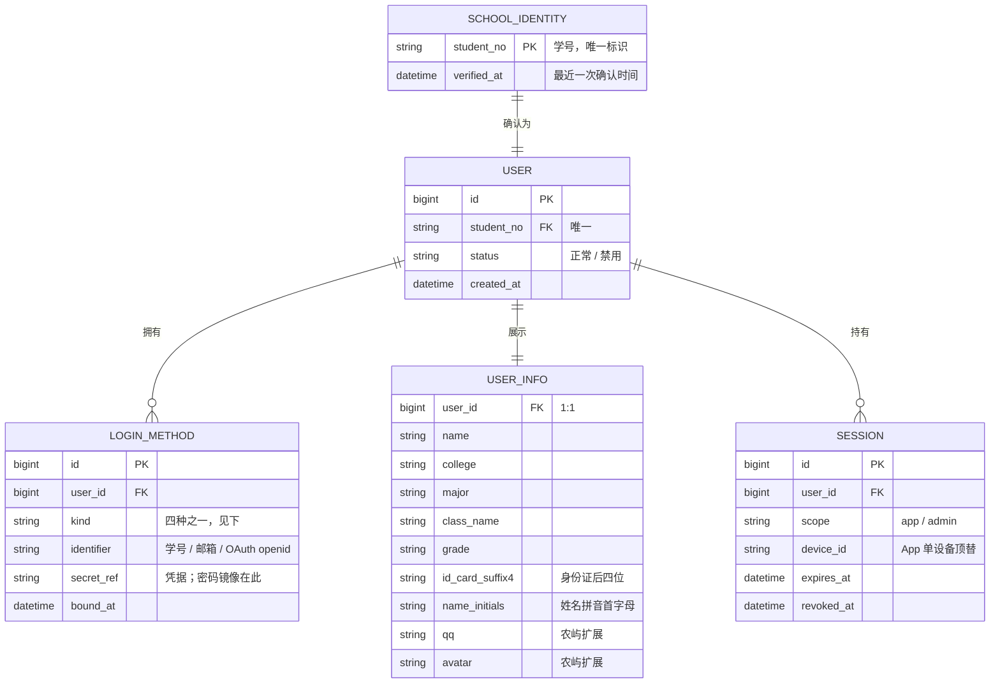

# 领域模型：用户与登录（含用户信息与密码镜像）

> 本文只画模型，不含实现（目录、表名、接口路径）。术语见 [GLOSSARY.md](../../GLOSSARY.md)。
> 状态：讨论稿，2026-11-08，**尚未落代码**。

## 更正记录

- 2026-11-08 初稿把「用户消息」误解为消息中心（通知/公告/私信），**这是错的**。维护者的意思是：**「用户消息」= 用户自己的数据（画像 / detail）**。旧农屿里也没有独立消息域。本文已按此重建，删去消息实体。

## 一、一张图

```
学校身份（学号）──1:1──▶ 用户 ──1:N──▶ 登录方式（四种）
                          │
                          └──1:1──▶ 用户信息（画像 / detail）
                          │
                          └──1:N──▶ 会话（app / admin 两套）
```

## 二、实体与关系



## 三、四种登录方式

| # | 登录方式 | 凭据 | 是否要求用户已存在 |
| --- | --- | --- | --- |
| 1 | **学校统一身份认证** | 学校账密 / 学校微信 / 学校电话 | 否——它是**唯一注册所需**的方式 |
| 2 | **农屿账密** | 学号 + 密码（见第四节「密码镜像」） | 是（用户不存在则需先走 1） |
| 3 | **农屿邮箱验证码** | 邮箱 + 验证码 | 是（同上） |
| 4 | **身份证后四位 + 姓名拼音首字母** | 学号 + 身份证后4位 + 姓名拼音首字母 | 是（同上） |
| 未来 | 手机号 / 微信 / QQ / Google / X 等 OAuth | 各提供方凭据 | 是（同上） |

**核心约束（维护者原话）**：*学校统一身份认证是唯一注册所需的，其他方式注册时也要再走这一步。*

所以「无感注册」对 2/3/4/OAuth 的表现是：**用户不存在 → 登录失败 → 引导走一次学校认证 → 回来建号并绑定该方式**。

## 四、密码镜像（本模型最需要被看清的一处）

**维护者决定**：用户用**学校统一身份认证的账密**登录农屿成功后，把该用户的**空密码**写为**学校统一身份认证的密码**；若该用户从未用账密登录过，农屿库里的密码保持为空。

模型上的含义：

- 农屿账密（登录方式 2）的 `secret_ref` **有一个"未设置"状态**，与"设置了"区分；
- "未设置"时，该用户不能走方式 2 登录；
- 一旦用户用学校账密登录成功，这条记录被写入（学校密码的加密副本）。

### 必须同时接受的后果（写在这里，避免以后误以为没权衡过）

1. **库泄 = 学校账号泄**。农屿库里存的是学生的学校密码，泄露范围从「农屿」扩大到「学校身份」。
2. **学校改密后农屿不自动跟随**。学生在学校改了密码，农屿存的是旧值，直到他再用新密码走一次学校认证登录才会更新。
3. **与学生账号使用规定的潜在冲突**。学校账号通常要求凭据不交由第三方保存；这是产品层面需要知情的风险，不在技术侧解决。

### 工程上必须做到的防线（不因为决定"存"就省略）

- **加密存储**：AES-256-GCM，密钥来自配置/密钥管理，绝不与应用代码同仓。
- **绝不回显**：任何接口、日志、审计、埋点、错误信息都不得包含密码或密文。
- **仅服务端使用**：只在「向学校发起认证」时在内存中解密，用完即弃。
- **可删除**：提供「清除我的农屿密码」的入口，清除后该用户只能走其它登录方式。
- **与审计分离**：审计只记 `action=login, method=password`，不记任何凭据。

## 五、用户信息（画像 / detail）

就是「用户消息」所指的东西。两部分：

| 来源 | 字段 | 谁能写 |
| --- | --- | --- |
| 统一身份认证下发 | 姓名、**身份证号**、生日、性别、手机号 | 只允许学校认证成功后由服务端写入 |
| 教务抓取（bjiben.asp） | 学院、专业、班级、年级 | 同上（统一身份认证**不下发**这些） |
| 派生 | 身份证后四位、姓名拼音首字母 | 由服务端从上面两项计算，不接受输入 |
| 农屿扩展 | QQ、头像、偏好设置 | 只允许本人修改 |

**关键事实（来自知识库实测）**：统一身份认证**只下发**姓名/身份证/生日/性别/手机号，**不下发**专业、班级、学院、年级、家庭住址 —— 后者必须从教务 `bjiben.asp` 抓取。所以画像需要**两条数据源**，不是一条。

**铁律**：用户信息里绝不出现任何凭据（密码、密文、令牌）。

**旧系统的教训**：旧实现在登录时用请求体**整体覆盖**画像字段，且 `qq` 之外无保护 —— 结果任何人报一个学号就能改写他人档案。新模型必须**按字段分权**：学校档案字段只接受服务端同步，不接受客户端提交。

**隐私口径（已被 ADR-0002 部分覆盖）**：原口径为「身份证号、个人电话、家庭电话不落库」。ADR-0002 已覆盖「身份证号不落库」这一句（改为加密落库且允许接口返回），其余（电话不落库、家庭住址默认不对外返回）**继续有效**。

## 五之二、权限（管理台）

沿用旧农屿的 role 三档，粒度是整条路由，不做资源级 ACL：

| role | 含义 |
| --- | --- |
| 0 | 普通用户 |
| 1 | 管理员 |
| 2 | 超级管理员 |

强制约定：

- **role 以数据库为准**，令牌中的 role 只作提示、不参与判定。
- **判定兜底必须 fail-closed**：无法判定时一律拒绝，不得默认放行。
- **区分「查不到」与「故障」**：查不到按无权处理，基础设施故障向上抛错，不得压成无权。

## 六、会话

- **两套互不影响**：`scope=app` 与 `scope=admin`。
- **App 单设备**：同一用户同时只有一个有效会话；新设备登录顶替旧设备，旧会话立即作废。
- **管理台**：复用同一条农屿账密登录（维护者已确认「复用」），但会话独立，且**必须有明确过期与吊销**（旧系统管理票永不过期，这是要修掉的洞）。
- 会话可吊销：吊销即失效，不等自然过期。

## 七、与旧农屿对照

| 维度 | 旧农屿 | 新模型 |
| --- | --- | --- |
| 用户创建 | 客户端报学号+姓名即建号，**零校验** | 必须由真实学校认证确认学号 |
| 登录方式 | 仅学校认证一条 | 四种 + 未来 OAuth，绑定同一用户 |
| 学生密码 | 无 | 学校账密登录时镜像学校密码；未登录过则为空 |
| 画像 | 单表 `users` 混装身份+画像+设备+角色 | 用户 / 用户信息 / 登录方式 / 会话 分开 |
| 画像写入 | 登录时请求体整体覆盖（**安全洞**） | 按字段分权：学校字段只服务端同步 |
| 会话 | 无状态 JWT；Admin 永不过期不可吊销 | 可吊销、有明确过期；App 单设备 |
| 消息中心 | 不存在（帖子派生通知） | **不做**——本次需求的「消息」是用户信息 |

## 八、已定与待定

**已定**（2026-11-08，维护者拍板）：

- 业务域命名为 `internal/identity/`，下设 `login/`、`session/`、`user/` 三个子域（与 `school/` 同构）。
- 令牌**可吊销**：每次鉴权查一次会话存储，接受「多一跳」换取能踢人。
- 邮箱验证码经 **SMTP** 发送。
- 其它业务域读画像**走 service**（不经裸仓储）。

**待定**：

1. **邮箱验证码存 PG 还是 Redis**：PG 可审计、Redis 适合短 TTL 高频读写。
2. **画像读取的域间约定具体形态**：让其它域依赖 `identity/user.Service`（需为 identity 开一个架构口子），还是做成 `platform` 接口由 user 域实现并注入。
3. **SMTP 的账号与发信域名**：需要配置项与一个可用发信账号。

（本文档为讨论稿，未产生任何代码改动。）
